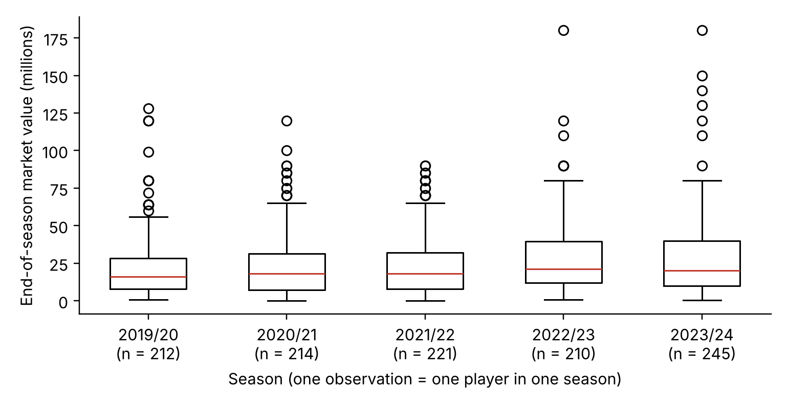
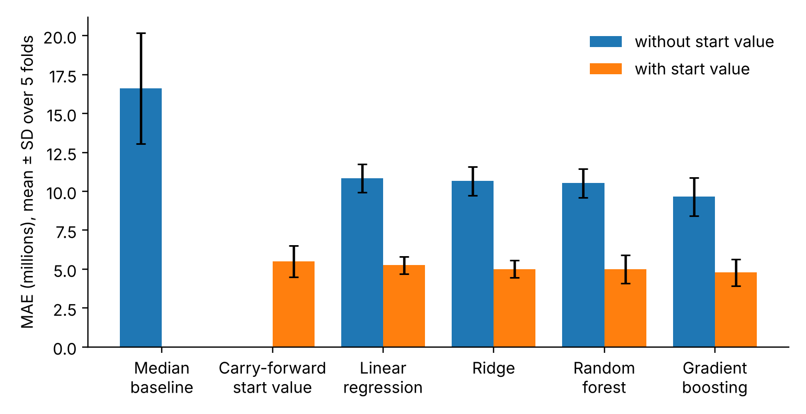
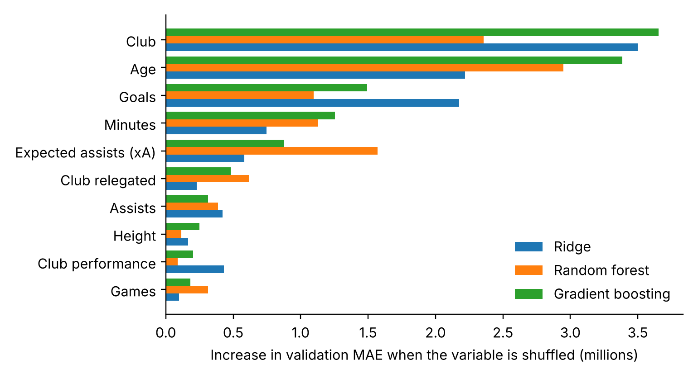
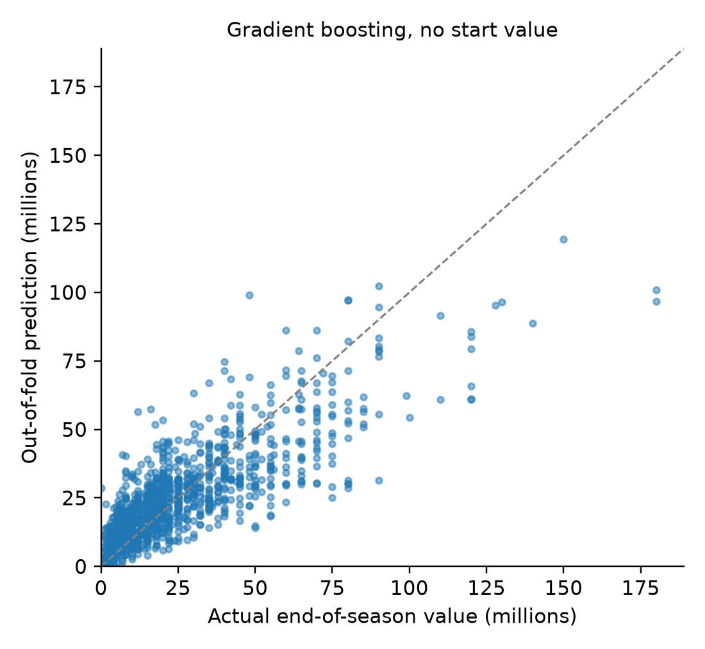

# SCOUT — Football Market Value Prediction


A machine learning project investigating the relationship between football player characteristics, on-field performance and estimated market values.

**IE University | Machine Learning & Communication Skills | 2026–2027**

**Authors:** Pablo Garma, Noa Keseric and Kristian Spassov

---

## Research Question

To what extent can player characteristics and performance statistics predict football players' estimated market values, and which features contribute most to predictive performance?

## Key Results

Our best-performing model by MAE is the **Histogram-Based Gradient Boosting Regressor**.

| Metric | Without starting value | With starting value |
|---|---:|---:|
| MAE | £8.242m | £4.118m |
| RMSE | £11.514m | £6.176m |
| R² | 0.6623 | 0.9029 |

Results are measured on the reserved test set of 132 players, comprising 279 player-season observations.

## Dataset

| Property | Description |
|---|---|
| Period | 2019–2023 |
| Usable observations | 1,381 |
| Players | 655 |
| Development set | 1,102 observations, 523 players |
| Reserved test set | 279 observations, 132 players |
| Target | End-of-season estimated market value |
| Currency | GBP, millions |

The dataset combines player characteristics, club information, performance statistics and expected goals and assists (xG and xA).

Missing values are handled within the preprocessing pipeline. Variables that directly reveal the target are excluded.

## Methodology

1. Data cleaning and integration with Understat.
2. Player-grouped 80/20 development-test split.
3. Median imputation, numerical scaling and categorical encoding.
4. Grouped five-fold cross-validation.
5. Hyperparameter tuning using development data.
6. Model comparison and feature importance analysis.
7. Evaluation on the reserved player set.

All seasons belonging to the same player remain together during grouped splitting.

Random seed: 42.

## Models

- Median baseline
- Carry-forward starting valuation
- Mean and median growth baselines
- Linear regression
- Ridge regression
- Random forest
- Histogram-based gradient boosting

The regression models are evaluated with and without starting market value to distinguish the predictive contribution of performance-related information from existing market valuations.

## Final Test Results

### Without starting market value

| Model | MAE (£m) | RMSE (£m) | R² |
|---|---:|---:|---:|
| Median baseline | 13.713 | 19.962 | -0.015 |
| Linear regression | 9.649 | 12.349 | 0.612 |
| Ridge regression | 9.448 | 12.330 | 0.613 |
| Random forest | 8.905 | 12.229 | 0.619 |
| **Gradient boosting** | **8.242** | **11.514** | **0.662** |

### With starting market value

| Model | MAE (£m) | RMSE (£m) | R² |
|---|---:|---:|---:|
| Carry-forward baseline | 5.322 | 8.175 | 0.830 |
| Mean growth baseline | 7.850 | 11.443 | 0.667 |
| Median growth baseline | 5.322 | 8.175 | 0.830 |
| Linear regression | 4.519 | 6.204 | 0.902 |
| Ridge regression | 4.462 | 6.313 | 0.898 |
| Random forest | 4.421 | 6.539 | 0.891 |
| **Gradient boosting** | **4.118** | **6.176** | **0.903** |

Full results: [Reserved Test Results](results/final/reserve_test_results.csv)

## Development Analysis

The following visualizations were generated during the development-stage analysis.

### Market Value Distribution



### Model Comparison



### Feature Importance



### Actual vs Predicted Values



## Key Findings

- Gradient boosting achieves the lowest reserved-set MAE in both predictor configurations.
- Without starting valuation, gradient boosting reduces MAE by approximately 40% relative to the median baseline.
- With starting valuation, gradient boosting reduces MAE by approximately 23% relative to the carry-forward baseline.
- Starting market value substantially improves predictive accuracy.
- Club and age are important predictors in the development analysis.
- Row-level validation can produce optimistic results when players appear across multiple seasons.

## Repository Structure

```text
Market-Value-Predictor/
├── data/                 Original and processed datasets
├── docs/                 Technical and team documentation
├── src/                  Models and experimental scripts
│   ├── data.py
│   ├── pipeline.py
│   ├── final_analysis.py
│   └── evaluate_reserve.py
├── results/
│   ├── final/            Main analysis and reserved test results
│   └── scout/            Earlier experiments
├── figures/
│   ├── final/            Main research visualizations
│   └── scout/            Earlier experimental visualizations
├── tests/                Automated checks
├── report/               Academic report materials
├── environment.yml
└── README.md
```

## Reproducibility

### Installation

```bash
git clone https://github.com/nkesericieu2025-arch/Market-Value-Predictor.git
cd Market-Value-Predictor
conda env create -f environment.yml
conda activate scout
```

### Run the analysis

```bash
python src/data.py
python src/final_analysis.py
python src/evaluate_reserve.py
```

### Run automated tests

```bash
python -m unittest discover -s tests -v
```

Earlier experiments are retained for transparency and reproducibility.

See the [Technical Team Guide](docs/TEAM_GUIDE.md) for historical development instructions.

## Limitations

- Estimated market values are not necessarily actual transfer prices.
- The dataset covers a limited historical period.
- Feature importance measures predictive association, not causation.
- End-of-season performance statistics must be available at prediction time.
- Player-grouped evaluation measures generalization across players, not necessarily future seasons.
- Earlier chronological experiments overlap with part of the reserved player set, so the reserve should not be described as completely untouched throughout the entire project.

## Data Sources

**Primary dataset**

Nisanov, R. *Transfer Value Determinants*, Version 2, Mendeley Data, CC BY 4.0.

https://doi.org/10.17632/3btg6ptc7b.2

**Expected goals and assists**

- [Understat](https://understat.com)
- [Understat Aggregated Player Dataset](https://github.com/vibedatascience/understat_players_aggregated)

Redistribution permission for the Understat export remains to be confirmed.

## AI Disclosure

Generative AI tools assisted parts of the development and documentation process. The team reviewed the implementation and evaluated the resulting models. Detailed disclosures are included in the academic submission.

---

Developed as an academic machine learning project at IE University.
